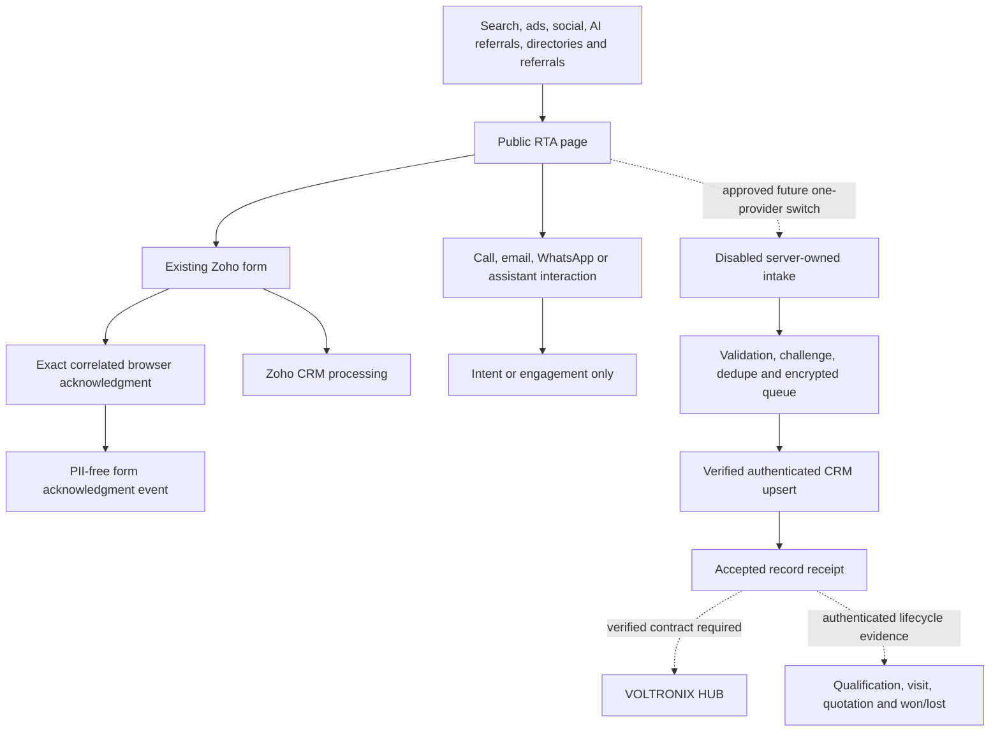

# Lead generation and privacy architecture

The existing client-side Zoho form remains the active provider. The new server intake, attribution and consent integration is **prepared and disabled**. It starts no listener, worker, notification or schedule on import and does not replace the provider form. Source flags record readiness decisions; they do not establish verified credentials, a lawful basis or provider acceptance.

## Current and prepared paths

The browser acknowledgment and CRM delivery are separate evidence boundaries. One prior authorised test independently matched the narrow current webform acknowledgment to a CRM record. That supports this specific receipt profile, not a promise that every future browser acknowledgment is durable, qualified or won. Telephone/email/WhatsApp clicks and assistant states are not delivery receipts. Direct messages, calls, social leads and tender opportunities need approved channel integrations or staff capture; no complete omnichannel intake is claimed.

## Executed CRM metadata work

The operator created and read back **19 additive, non-mandatory RTA Lead fields**, increasing the field count from 97 to 116. The previous fields and global `Lead_Status` behavior were preserved; no Lead records were changed by this field setup. `RTA_Submission_ID` is a verified unique text key. The additions cover exact website/form context, campaign attribution, consent metadata, a technical-test flag, an RTA-specific lifecycle field and dedicated writable `RTA_GCLID`/`RTA_MSCLKID` fields. Click IDs require known advertising consent and a 255-character bound. Standard `GCLID` remains unmapped because its metadata is read-only/API-update false, which is unsuitable for idempotent upsert retries. Actual field/organization identifiers and record contents are intentionally omitted.

The existing `Website` field describes the customer website and must not be overwritten with our source origin. Standard channel labels do not establish exact RTA-domain history. The source fixes the independently verified company/department assignment and does not change global picklists. Intake retries must not reset a progressed lead's lifecycle. Creating fields alone establishes no historical capture coverage, accepted API write, automation safety or reporting integration.

## Prepared secure intake

[server/lead-service](../../server/lead-service/README.md) defines explicit validated contact/project fields, same-key payload checks, recent-enquiry deduplication and a server-owned source/form context. First and last names are explicit; no contact name is guessed by splitting a string. Project name and the server-owned context belong to enquiry identity. Personal text, raw URLs and contact details are never copied to analytics.

An optional server-owned form obtains an age-bounded challenge, then submits with a stable random idempotency key. A durable queue response is **queued, accepted:false**, not a conversion. The client status endpoint returns status only. A same-key changed body is rejected; a fresh-key alias of a recent identical enquiry does not become another conversion. Retries retain the original key/body. Only a verified record-level CRM success receipt may promote delivery to accepted.

Ambiguous or unrecognized provider receipts after a possibly sent write require reconciliation or bounded retry through a separately verified external-ID-idempotent adapter. HTTP 200, a queue entry or a health endpoint cannot establish record acceptance. HUB delivery follows CRM acceptance and does not resubmit CRM when HUB fails. HUB endpoint/authentication/schema, receipt signature, replay handling and deduplication are still unverified, so that path remains disabled.

The encrypted state store requires a dedicated private path outside the checkout and public tree, safe ownership/permissions, a server-only stable encryption key and protected backup/rotation. The final independent review and isolated regression checks address deduplication/project/context, private-store path/permissions and ambiguous receipts. These local fixtures do not establish Linux durability/permissions or real API behavior. Final test status is recorded in [deployment validation](deployment-and-validation.md); secure credentials and contract gates remain regardless of test success.

## Consent and attribution

[Public marketing configuration](../../website/marketing.config.mjs) keeps activation, attribution, consent and server form capture off. The existing GTM loader remains active as before; the disabled controller cannot be described as controlling current tracking. Future activation requires a reviewed coordinated GTM version, granular purpose gates for **every** vendor base/event/custom/conversion tag, verified URL/referrer policy and sole loader ownership. A build policy rejects partial activation.

The prepared controller has independent analytics and advertising choices, denied defaults before a sole GTM bootstrap and explicit withdrawal behavior. Google, UET and Clarity consent APIs require actual platform verification. Existing Zoho, SalesIQ and AI services outside GTM need their own reviewed purpose/loading decisions; this controller does not silently block them or promise universal consent enforcement.

Attribution requires the corresponding explicit choice. It keeps bounded approved context and last non-direct touch, not arbitrary full referrers; only reviewed public campaign values may remain in vendor page URLs. Identifiable AI referrals are heuristic, not a complete count of AI influence. Consent metadata is a representation of the choice, not proof of legal compliance. No personal information belongs in UTM values, advertising URLs, data-layer events, browser dashboards or public logs.

Qualification, site visit, quotation and won/lost processing must come from authenticated, replay-protected CRM/HUB evidence for an existing accepted record. There is no unauthenticated lifecycle webhook or active transport. One agreed event owner is required before client/server success transport can be activated. Closed stage, quote value and revenue require real verified field semantics and joins; they are not inferred from a button click or a generic pipeline label.
